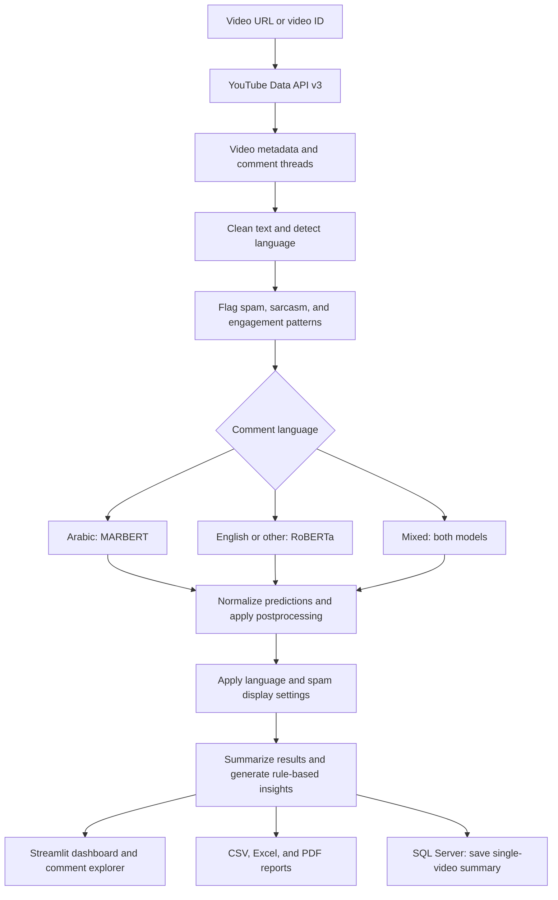

<div align="center">

# YouTube Sentiment Analyzer PRO

### Read the reaction. Understand the audience.

A visual workspace for exploring YouTube comments with Arabic and English sentiment analysis.

**Local Transformer Models · Interactive Dashboards · Video Comparison · Exportable Reports**


[Product Tour](#product-tour) · [Features](#features) · [Get Started](#getting-started) · [How It Works](#how-it-works)


</div>

## Overview

**YouTube Sentiment Analyzer PRO transforms a video's comment section into an interactive picture of audience feedback.** Collect comments, classify their sentiment, identify spam and sarcasm signals, inspect discussion topics, and compare reactions across two videos.

Built with **Python and Streamlit**, the application combines fine-tuned **MARBERT** and **RoBERTa** models with deterministic text rules and Plotly visualizations. It brings comment exploration, keyword analysis, automatic statistical insights, and downloadable reports into a single interface.

Use it to investigate what viewers respond to, find recurring feedback, and support content decisions with the comments behind the numbers.

> **Project lineage:** this repository contains the original Streamlit application that preceded [SentimentPRO](https://github.com/ismailhalawa-ctrl/SentimentPro-youtube). The newer platform extends the idea with a FastAPI/Next.js architecture, LLM insights, and an audience assistant.

<details>
<summary><strong>نبذة بالعربية</strong></summary>

مشروع لتحليل تعليقات فيديوهات YouTube وفهم انطباع الجمهور من خلال واجهة تفاعلية مبنية بـ Streamlit. يدعم تحليل المشاعر بالعربية والإنجليزية، والتعليقات المختلطة، واكتشاف مؤشرات السبام والسخرية، واستخراج الكلمات والموضوعات المتكررة.

يمكنك استعراض التعليقات، مقارنة نتائج فيديوهين، تنزيل تقارير CSV وExcel وPDF، والاطلاع على ملخّصات التحليلات المحفوظة في SQL Server. يعتمد تحليل المشاعر على نماذج محلية، بينما تعتمد الرؤى والتوصيات في هذه النسخة على قواعد وعتبات إحصائية.

</details>

## At a Glance

| Explore | Understand | Share |
|---|---|---|
| YouTube video comments and metadata | Positive, neutral, and negative sentiment | Comment-level CSV exports |
| Arabic, English, and mixed-language feedback | Spam, sarcasm, keywords, and predefined topics | Multi-sheet Excel workbooks |
| Two videos side by side | Audience reaction and engagement patterns | PDF summaries with charts |

## Contents

- [Product Tour](#product-tour)
- [Features](#features)
- [How It Works](#how-it-works)
- [Models and Analysis Logic](#models-and-analysis-logic)
- [Getting Started](#getting-started)
- [Database Setup](#database-setup)
- [Using the Application](#using-the-application)
- [Reports and Stored Data](#reports-and-stored-data)
- [Technology Stack](#technology-stack)
- [Project Structure](#project-structure)
- [Troubleshooting](#troubleshooting)
- [Scope and Limitations](#scope-and-limitations)
- [Project Evolution](#project-evolution)
- [Contributing](#contributing)
- [Author and License](#author-and-license)

## Product Tour

### Configure Your Analysis

Choose single-video analysis or comparison mode, set the number of comments, choose relevance or chronological order, and adjust the classification confidence threshold. The interface includes English and Arabic language controls.


### Explore the Dashboard

Review sentiment and language distributions alongside video metadata, spam and sarcasm counts, confidence, and engagement indicators. Interactive charts help reveal patterns before you inspect individual comments.

The opening screenshot shows this analytics workspace.

### Inspect the Comments

Search the discussion and inspect comment cards with sentiment labels, confidence information, and engagement details. Use the available filters and views to focus on the feedback relevant to your question.


### Compare Two Videos

Place two videos in the same workspace and compare their sentiment percentages, analyzed comment counts, spam counts, and average confidence. A grouped chart makes differences in audience reaction easy to scan.


*All four original product screenshots are preserved. Results vary with the selected videos, fetched comments, and analysis settings.*

## Features

### Arabic and English Sentiment Analysis

- Classifies comments as **positive**, **neutral**, or **negative**.
- Uses a fine-tuned **MARBERT** classifier for Arabic.
- Uses **RoBERTa** for English, with the same route used as a fallback for the `other` language category.
- Runs both models for mixed Arabic/English comments and reconciles their predictions.
- Applies a configurable confidence threshold and emoji-aware adjustments.
- Uses batched inference and automatically selects CUDA when available, otherwise CPU.

### Comment Quality Signals

**Spam detection** looks for suspicious links, promotional phrases, phone and WhatsApp numbers, repeated content, excessive characters or emojis, and other rule-based signals. Flagged comments retain a reason for inspection.

**Sarcasm detection** uses phrase, emoji, and contrast patterns. The result is an indicator that helps interpret a comment; it is not a dedicated sarcasm model.

### Interactive Analytics

- Sentiment distribution and comment-count charts.
- Language breakdown for Arabic, English, mixed, and other comments.
- Sentiment activity over time.
- Likes versus sentiment-confidence exploration.
- Comment-level search and inspection.
- Spam review and adjustable display filtering.
- Keyword frequencies by positive, negative, and neutral sentiment.
- Word clouds when the WordCloud dependency is available.

### Keywords, Topics, and Insights

Keyword analysis removes common stopwords and noise terms, normalizes Arabic characters, and counts frequent words within each sentiment group.

Topic analysis matches comments against a predefined bilingual keyword dictionary covering areas such as **acting, music, pacing, visuals, lighting, AI, gaming, education, story, and direction**.

The interface's **AI Insights** and **Actionable Insights** use deterministic rules over sentiment percentages, engagement, language mix, spam, sarcasm, and confidence. They provide quick interpretations and recommendations without an OpenAI or Gemini key.

### Video Comparison

Analyze **two videos per comparison** using the selected comment limit, ordering, and confidence threshold. The comparison presents video/channel information, a summary table, and a grouped sentiment chart.

The “winner” badge reflects the higher positive-comment percentage in the analyzed data. Treat it as a narrow sentiment comparison, rather than an overall measure of video quality or business performance.

### Reports and History

| Capability | What you receive |
|---|---|
| **CSV** | The current analyzed comment table |
| **Excel** | Summary, all comments, sentiment-specific sheets, spam, and keywords |
| **PDF** | Video title, sentiment summary, generated insights, and charts |
| **History** | SQL Server records containing video details, sentiment percentages, comment count, and timestamp |

The current analysis is held in Streamlit session state. Database history stores aggregate summaries; it does not persist the complete comment table for reopening a past session.

## How It Works



The application runs as a single Streamlit process. It fetches public video data through the YouTube API, performs model inference locally, and uses [database.py](database.py) to save and retrieve summary records.

## Models and Analysis Logic

| Component | Current implementation |
|---|---|
| Arabic model | `Ammar-alhaj-ali/arabic-MARBERT-sentiment` |
| English model | `cardiffnlp/twitter-roberta-base-sentiment-latest` |
| Language routing | Arabic/Latin character ratios after cleaning |
| Mixed-language decision | Average confidence when labels agree; higher-confidence prediction when they differ |
| Inference | Hugging Face pipelines, batch size 32, CUDA or CPU |
| Text limits | Model inputs are sliced to 512 characters and tokenized with a 256-token maximum |
| Confidence control | Sidebar threshold from 0.30 to 0.90; default 0.55 |
| Insights | Rules and thresholds over aggregate metrics |
| Topics | Predefined Arabic/English keyword matches |

### Reading the Results

The final label can differ from the model's initial prediction because the application applies additional rules:

1. Spam comments receive a neutral label and a score of 1.0.
2. Engagement-only patterns are handled separately from opinionated feedback.
3. Positive and negative emojis can adjust the label or score.
4. Sarcasm signals can reduce confidence in a positive prediction.
5. Predictions below the selected threshold become neutral.

These rules also affect aggregate metrics. In particular, **average confidence includes adjusted and rule-assigned scores**; it is not an evaluation accuracy score. Keep spam visibility and language filters consistent when comparing analyses.

See [app.py](app.py) for model loading, language routing, postprocessing, and chart logic.

## Getting Started

### Prerequisites

- **Python 3.10 or newer** for the type syntax used in the source, with compatible PyTorch/Transformers packages.
- **Git** and a Python virtual environment.
- A **YouTube Data API v3 key** with the API enabled in Google Cloud.
- **SQL Server** and an installed ODBC driver compatible with the connection string.
- Internet access for YouTube requests and the initial Hugging Face model downloads.

The supplied database configuration uses Windows integrated authentication. A Windows development environment with SQL Server is the most direct match; other environments need an appropriate ODBC driver and authentication configuration.

### 1. Clone the Repository

```bash
git clone https://github.com/ismailhalawa-ctrl/YouTube-Sentiment-Analyzer.git
cd YouTube-Sentiment-Analyzer
```

### 2. Create a Virtual Environment

```bash
python -m venv .venv
```

Activate it using the command for your shell:

```powershell
# Windows PowerShell
.\.venv\Scripts\Activate.ps1
```

```bash
# macOS / Linux
source .venv/bin/activate
```

### 3. Install Dependencies

```bash
python -m pip install -r Requirements.txt
```

Use the exact filename **`Requirements.txt`**, including the capital **R**, on case-sensitive filesystems. The repository's dependency list is unpinned; it does not define a tested package-version lock.

For GPU inference, install a PyTorch build compatible with your CUDA environment.

### 4. Configure the YouTube API Key

Create a file named `.env` in the repository root:

```dotenv
YOUTUBE_API_KEY=your_youtube_data_api_v3_key
```

The application loads this value with `python-dotenv`. The repository ignores `.env`; keep the real key out of source control.

### 5. Prepare SQL Server

Complete [Database Setup](#database-setup) before running a single-video analysis. The application saves its summary as part of that workflow, so database configuration is a required setup step for normal use.

### 6. Launch the Application

Run from the repository root:

```bash
python -m streamlit run app.py
```

Open the local URL printed by Streamlit, normally [localhost:8501](http://localhost:8501).

The first analysis downloads the two model checkpoints. Streamlit caches the loaded models as resources so subsequent analyses can reuse them.

## Database Setup

### Create the Database and Table

Run the following script in SQL Server Management Studio or another SQL Server query tool:

```sql
CREATE DATABASE YouTubeSentimentAnalyzer;
GO

USE YouTubeSentimentAnalyzer;
GO

CREATE TABLE dbo.analyses (
    id INT IDENTITY(1,1) PRIMARY KEY,
    video_id NVARCHAR(100),
    video_title NVARCHAR(MAX),
    positive_percent FLOAT,
    negative_percent FLOAT,
    neutral_percent FLOAT,
    total_comments INT,
    created_at DATETIME DEFAULT GETDATE()
);
GO
```

The `GO` lines are batch separators recognized by tools such as SSMS. When executing through a different client, run the database creation and table creation as separate batches if needed.

### Configure the Connection

Edit [database.py](database.py) to match your SQL Server instance. For a local default instance with Windows authentication:

```python
SERVER = "localhost"
DATABASE = "YouTubeSentimentAnalyzer"

connection_string = f"""
DRIVER={{SQL Server}};
SERVER={SERVER};
DATABASE={DATABASE};
Trusted_Connection=yes;
"""
```

Replace the committed `Local_Host` placeholder with your real server or named instance. Use a driver name that appears in the installed ODBC drivers:

```bash
python -c "import pyodbc; print(pyodbc.drivers())"
```

If using a modern driver such as ODBC Driver 18, update `DRIVER` and configure encryption/certificates for that driver and server. For SQL authentication or a non-Windows host, adapt the connection string and load credentials from environment variables.

The Windows account running Streamlit needs permission to insert into and read from `analyses`.

### What Gets Saved

Each completed single-video analysis inserts a summary record. Reanalyzing a video creates another record, allowing the history table to show separate runs ordered by their creation time.

Stored fields are **video ID**, **video title**, **positive/negative/neutral percentages**, **analyzed comment count**, and **timestamp**.

## Using the Application

### Single-Video Workflow

1. Select **Single Video** in the sidebar.
2. Choose a comment limit and ordering.
3. Set the confidence threshold, reply inclusion, language selection, and spam visibility.
4. Paste a video URL or video ID and select **Analyze**.
5. Inspect the available workspaces:

| Workspace | Purpose |
|---|---|
| **Overview** | Video information, charts, summary metrics, statistical insights, and PDF download |
| **Comments** | Search and inspect analyzed comments |
| **Keywords** | Frequent words and sentiment-specific keyword views |
| **Spam** | Review comments flagged by spam rules |
| **Insights** | Rule-based recommendations, positive/negative topics, and methodology |
| **Export** | Download CSV/Excel and copy summary text |
| **History** | Read saved summary rows from SQL Server |

### Settings That Change the Analysis

| Setting | Behavior |
|---|---|
| **Specific Number** | Fetches a selected limit from 50 to 10,000 comments; default 300 |
| **All Comments** | Continues through available API pages until exhausted |
| **Order** | `relevance` prioritizes relevant comments; `time` prioritizes newer comments |
| **Include replies** | Adds reply objects returned within comment-thread responses |
| **Confidence threshold** | Converts low-confidence predictions to neutral |
| **Language filtering** | Selects which language groups are retained in the displayed dataset |
| **Show Spam Comments** | Controls whether flagged spam remains in the displayed dataset |

Reply inclusion uses the replies embedded in the thread response; the implementation does not paginate every thread's full reply history. “All Comments” therefore refers to available thread pages and included reply objects, rather than a guarantee of every reply on YouTube.

Language and spam filtering are applied before the single-video summary is saved and exported. Changing sidebar settings does not automatically rerun the stored session analysis; analyze again to apply them to a new result.

### Comparison Workflow

Switch to **Compare Two Videos**, enter both URLs, and start the comparison. Review the sentiment chart and table using the same comment limit, order, and confidence threshold for a more consistent comparison.

The comparison function has its own collection path: it fetches top-level comments and does not apply the single-video reply-inclusion or display-filter controls.

## Reports and Stored Data

### Export Formats

| Format | Contents | Location in the App |
|---|---|---|
| **CSV** | Current comment rows, metadata, sentiment, scores, language, and quality flags | Export |
| **Excel** | `Summary`, `All Comments`, `Positive`, `Negative`, `Neutral`, `Spam`, `Keywords` | Export |
| **PDF** | Video title, sentiment percentages, generated insights, sentiment charts, and language chart | Overview |

Excel generation uses **openpyxl**. PDF generation uses **ReportLab** and **Matplotlib**. CSV output includes a UTF-8 byte-order mark to help spreadsheet tools display Arabic text.

### Session and History

The full analyzed DataFrame and current video details live in **Streamlit session state**. **SQL Server history** keeps summary rows only. Export the comment-level data before ending the session if you need to retain it.

Generated PDF/chart files are written to the application's working directory. The PDF uses a fixed filename, `report.pdf`, so isolated per-session output paths would be needed for a concurrent multi-user deployment.

## Technology Stack

| Layer | Technologies |
|---|---|
| **Application and interface** | Python, Streamlit, custom HTML/CSS, Arabic/English UI controls |
| **Sentiment models** | Hugging Face Transformers, PyTorch, MARBERT, RoBERTa |
| **Data collection** | YouTube Data API v3, google-api-python-client |
| **Data processing** | Pandas, regular expressions, Python collections |
| **Interactive charts** | Plotly |
| **Reports and visualization** | ReportLab, Matplotlib, WordCloud, openpyxl |
| **Persistence** | SQL Server, pyodbc |
| **Configuration** | python-dotenv |

## Project Structure

```text
YouTube-Sentiment-Analyzer/
├── app.py                              Streamlit UI and analysis pipeline
├── database.py                         SQL Server save/read functions
├── Requirements.txt                    Python dependencies
├── YouTubeCommentAnalyzer (3).ipynb     Exploration and development notebook
├── screenshots/
│   ├── home.png                        Analysis settings and home interface
│   ├── dashboard.png                   Analytics overview
│   ├── commentsanalysis.png            Comment explorer
│   └── comparison.png                  Two-video comparison
├── .gitignore                          Ignores the local .env file
└── README.md                           Project guide
```

Create `.env` locally during setup. A template file is not currently included in this repository.

### Code Guide

| Function or file | Responsibility |
|---|---|
| `get_video_info()`, `get_comments()` | Fetch video metadata and paginated comment threads |
| `clean_text()`, `detect_language()` | Prepare text and select a language route |
| `detect_spam()`, `detect_sarcasm()` | Produce rule-based quality signals |
| `analyze_sentiment()` | Run models and apply final classification rules |
| `summarize_results()`, `generate_ai_insights()` | Build aggregate metrics and statistical interpretations |
| `get_top_words()`, `get_topics()` | Extract keyword frequencies and predefined topic matches |
| `render_*` functions | Display dashboard sections, exports, and comparison |
| `generate_pdf_report()` | Build the PDF report |
| [database.py](database.py) | Insert and retrieve analysis summary records |

## Troubleshooting

| Symptom | What to Check |
|---|---|
| Dependency file not found | Run from the repository root and use `Requirements.txt` with the correct capitalization |
| Missing or invalid YouTube key | Confirm the root `.env` contains `YOUTUBE_API_KEY` and YouTube Data API v3 is enabled |
| Quota or rate-limit error | Reduce collection size or wait for the API quota to become available |
| No comments returned | Check whether comments are disabled or the video is unavailable |
| SQL Server connection error | Replace `Local_Host`, confirm the instance is running, check the ODBC driver and Windows account permissions |
| Invalid object name `analyses` | Create the table in `YouTubeSentimentAnalyzer`, then verify the configured database |
| Slow first analysis | Allow initial model downloads to finish; later runs reuse cached model resources |
| GPU is not used | Check `torch.cuda.is_available()` and your installed PyTorch/CUDA build |
| Excel download unavailable | Install openpyxl in the same virtual environment used by Streamlit |
| Arabic or emoji glyphs missing in PDF | Review ReportLab font support and add suitable fonts/shaping when extending PDF output |

## Scope and Limitations

- **Dataset coverage:** the selected order, comment limit, available replies, and API access determine the analyzed sample.
- **Language routing:** character ratios are a heuristic. The `other` category uses the English pipeline and does not imply broad multilingual model coverage.
- **Model context:** input slicing and token truncation can shorten long comments. Dialect, irony, and ambiguous language can affect predictions.
- **Neutral labels:** these include low-confidence classifications, spam, and some engagement patterns, as well as genuinely neutral opinions.
- **Topic coverage:** topics come from a fixed keyword dictionary. Their absence does not mean a topic is absent from the discussion.
- **Statistical insights:** recommendations summarize observed patterns; they are not LLM-generated explanations or validated audience satisfaction measures.
- **Application scope:** this version is a Streamlit prototype with synchronous analysis and a shared summary database. User accounts, RAG chat, and selectable FAST/SMART/HYBRID modes belong to the newer platform.

## Project Evolution

This application established the core workflow: **collect → classify → visualize → compare → export**.

The project later evolved into [**SentimentPRO**](https://github.com/ismailhalawa-ctrl/SentimentPro-youtube), which adds a separate frontend/backend, account-based history, optional LLM analysis, executive summaries, personas, complaints and suggestions, FAQs, topic clustering, audience intelligence, and an evidence-grounded assistant.

| This Repository | SentimentPRO |
|---|---|
| Single Streamlit application | Next.js frontend and FastAPI backend |
| Local MARBERT/RoBERTa analysis | FAST, SMART, and HYBRID processing strategies |
| Rule-based statistical insights | Optional LLM-generated insights |
| Keyword-based topic matching | Extended audience-analysis capabilities |
| SQL Server aggregate history | User accounts and richer persisted analysis data |
| Two-video comparison workspace | Broader dashboard and assistant workflows |

Possible improvements for this prototype include pinned dependencies, automated regression tests, configurable database settings, per-session report files, and broader evaluation of dialect and mixed-language behavior.

## Contributing

Contributions to documentation, analysis quality, accessibility, and reliability are welcome.

1. Describe the issue or proposed improvement in the [issue tracker](https://github.com/ismailhalawa-ctrl/YouTube-Sentiment-Analyzer/issues).
2. Create a focused branch and explain the resulting behavior.
3. Check the relevant single-video, comparison, export, or database workflow.
4. Open a pull request with the steps used to validate the change.

The repository currently has no automated test suite or CI workflow. For local syntax checks:

```bash
python -m py_compile app.py database.py
```

Syntax checks do not validate model predictions, YouTube access, database connectivity, or the rendered interface.

## Author and License

Created by **Ismail Halawa**.

[GitHub Profile](https://github.com/ismailhalawa-ctrl) · [SentimentPRO](https://github.com/ismailhalawa-ctrl/SentimentPro-youtube)

The project is identified as **MIT licensed** in its existing documentation. A standalone license file is not currently included in this repository. Model weights and third-party services are subject to their own licenses and terms.

---

<div align="center">

<strong>Understand the conversation behind the view count.</strong>

[Back to top](#youtube-sentiment-analyzer-pro)

</div>

